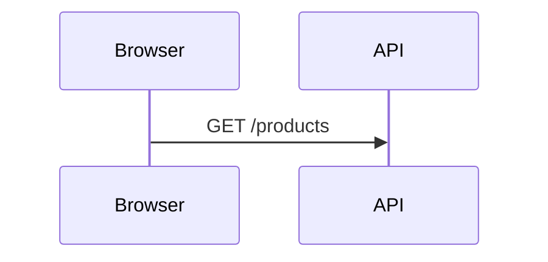
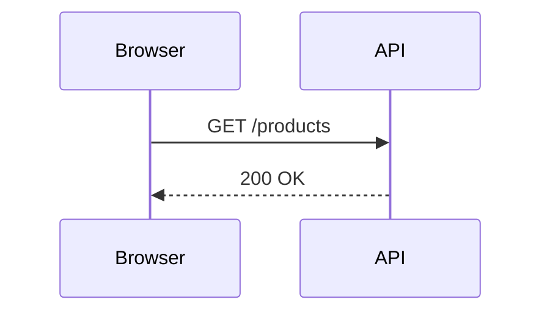

# Sequence Flow

Sequence Flow is a small, open-source developer primitive from [Canadian AI](https://canadian-ai.ca) for rendering Mermaid `sequenceDiagram` syntax as an interactive React Flow canvas and chaining multiple diagrams into progressive journeys.

It is intentionally narrow: install the component into a React application, pass Mermaid text to `SequenceDiagram` or a `JourneySlide[]` to `JourneyPlayer`, and render readable technical flows with pan, zoom, hover highlighting, activation bars, return messages, notes, self-messages, grouping boxes, and guided walkthroughs.

## Install

```bash
npx shadcn@latest add canadian-ai/sequence-flow/sequence-diagram
```

This GitHub source registry is the canonical install path. The hosted endpoint remains available for backwards compatibility:

```bash
npx shadcn@latest add https://sequence-flow.canadian-ai.app/r/sequence-diagram.json
```

`registry.json` is the source of truth for the component definition. The generated `public/r/*.json` files are a compatibility layer for existing consumers of the hosted registry URL.

## Pass a sequence flow

Use `SequenceDiagram` in any height-constrained container:

```tsx
import { SequenceDiagram } from "@/components/ui/sequence-diagram"

const chart = `sequenceDiagram
    participant B as Browser
    participant S as Server
    B->>S: Request
    S-->>B: Response`

export function Example() {
  return (
    <div className="h-[400px]">
      <SequenceDiagram chart={chart} />
    </div>
  )
}
```

## Pass a journey as JSON / TypeScript

A journey is an array of `JourneySlide` objects. Each slide owns a standalone Mermaid sequence diagram plus optional title, caption, and per-message commentary.

```tsx
import {
  JourneyPlayer,
  type JourneySlide,
} from "@/components/ui/sequence-diagram"

const journey: JourneySlide[] = [
  {
    id: "request",
    title: "Step 1 — Request",
    caption: "The browser sends a request to the API.",
    chart: `sequenceDiagram
      participant B as Browser
      participant A as API
      B->>A: GET /products`,
  },
  {
    id: "response",
    title: "Step 2 — Response",
    caption: "The API returns the result to the browser.",
    chart: `sequenceDiagram
      participant B as Browser
      participant A as API
      B->>A: GET /products
      A-->>B: 200 OK`,
  },
]

export function JourneyExample() {
  return <JourneyPlayer slides={journey} />
}
```

You can also provide `messageCaptions` on each slide when you want narration to appear as individual messages reveal. Journey caption surfaces use the host's `card` / `card-foreground` tokens so narration stays readable even when the host OS color scheme differs from a locally selected journey theme.

### Journey pacing

Journey reveals are paced for reading rather than micro-interaction speed. Sequence Flow uses a conservative **160 WPM** default based on sixth-grade reading/fluency research, adds a short orientation beat for technical labels, and uses a **650 ms** traveling packet so the eye can follow each edge. Even a one-word label gets at least **1.6 seconds** before the next message starts, while longer labels receive proportionally more time up to a bounded maximum.

Use a Mermaid `%% duration: <ms>` annotation when a specific message needs a deliberate custom hold. The `speed` prop still scales the full animation schedule.

## Write a journey in Markdown

`parseJourneyMarkdown` lets you author the same `JourneySlide[]` model in a readable Markdown document. Each `##` heading becomes a slide, ordinary Markdown becomes the slide caption, and a fenced `mermaid` block contains the diagram.

````md
# Request lifecycle

A progressive walkthrough for the request path.

## Step 1 — Request
<!-- @id: request -->
<!-- @message: The browser sends the request to the API. -->
The browser begins the request lifecycle.



## Step 2 — Response
<!-- @id: response -->
<!-- @message: The browser sends the request to the API. -->
<!-- @message: The API returns the product payload. -->
The response completes the round trip.


````

Then compile and render it:

```tsx
import {
  JourneyPlayer,
  parseJourneyMarkdown,
} from "@/components/ui/sequence-diagram"

const markdown = `...`
const journey = parseJourneyMarkdown(markdown)

export function JourneyExample() {
  return <JourneyPlayer slides={journey.slides} />
}
```

Supported Markdown annotations:

- `<!-- @id: stable-id -->` sets the slide ID.
- Repeated `<!-- @message: narration -->` annotations populate `messageCaptions` in reveal order.
- `<!-- @caption: narration -->` is accepted as an alias for `@message`.
- A top-level `#` heading is returned as the document title.
- Text before the first slide is returned as the document description.

If `messageCaptions` is omitted, `JourneyPlayer` can still reuse `%% tooltip:` annotations inside Mermaid as step commentary.

## Live editor

The demo site includes two mobile-responsive editor tabs:

- **Sequence flow** — edit Mermaid sequence syntax, preview the canvas, tune the theme, and export the diagram.
- **Journey** — switch between **Markdown** and **JSON**, preview the progressive walkthrough, choose a live theme, and copy the full React usage.

The code views are designed for full copy-and-paste usage so the rendered example and the integration snippet stay next to each other.

## Test suite

The repository includes regression coverage for the public component surface:

- sequence parser behavior and Mermaid annotations
- journey Markdown parsing and validation
- layout graph generation and reveal scheduling
- shadcn registry completeness for the Journey runtime
- browser smoke coverage for the Journey editor and theme controls

Run the unit/integration suite with:

```bash
pnpm test
```

Run browser smoke tests with:

```bash
pnpm dlx playwright@1.54.2 install chromium
pnpm test:e2e
```

The GitHub Actions workflow runs unit/integration tests, a production Next.js build, and browser smoke coverage for every pull request.

## What this repo is

- A reusable React component for technical diagrams.
- A progressive journey player for multi-step technical walkthroughs.
- A Markdown-to-`JourneySlide[]` compiler for annotated journey documents.
- A small Mermaid-compatible parser and layout layer for sequence diagrams.
- A shadcn registry package developers can copy directly into their applications.
- A demo playground for testing diagrams, journeys, and the component API.

## What this repo is not

- A hosted diagramming SaaS.
- A project-management or collaboration product.
- A backend service or proprietary Canadian AI runtime.
- Documentation for Canadian AI's private platform internals.

The public repository contains only the generic developer-facing primitive. Canadian AI's internal runtime, application architecture, and proprietary platform implementation remain in private repositories.

## Supported syntax

Sequence Flow supports the most common `sequenceDiagram` primitives:

- `participant` and `actor`
- synchronous and asynchronous messages
- dashed return messages
- activation and deactivation bars
- self-messages
- notes
- participant grouping boxes

Unsupported control-flow blocks are ignored gracefully so partial diagrams can still render.

## Development

```bash
pnpm install
pnpm dev
```

Open `http://localhost:3000` to use the playground.

## License

MIT © 2026 Canadian AI Solutions Inc. See [LICENSE](./LICENSE).

## Share journeys without publishing customer artifacts

In the hosted Journey editor, choose **Copy journey URL**. The link opens at `/journey#data=<encoded-artifact>` and carries the entire JSON journey in the browser URL fragment. Sequence Flow does not save the document to a server or repository. Anyone with the complete link can read it, so **do not use this mode to share secrets or confidential journeys**. Use private, authenticated storage for restricted content.

For large journeys, export a self-contained HTML file instead of making an unusually long URL. The component remains a reusable public visualization primitive; customer-specific journeys and workflows must live outside this open-source repository.

### Load a journey via HTTP query

The hosted viewer supports `/journey?slug=<public-slug>`. It performs a read-only GET against an external journey storage service. The user-specific journey content is **not** included in the open-source repository, build, or Git history. This is intended for publicly shareable, non-confidential journeys only; anyone with the slug can read the artifact. Fragment-based `/journey#data=...` links remain supported for fully self-contained journeys.

## Free short-lived publishing (HTTP and MCP)

The hosted editor's **Publish free** action publishes a temporary public journey outside this repository. Choose **1 hour, 24 hours, or 7 days**. The publisher uses a separate Cloudflare Worker and KV with automatic expiry; it does not create a GitHub commit or charge Canadian AI credits.

- Public viewer: `https://sequence-flow.canadian-ai.app/journey?slug=<generated-random-slug>`
- Public read API: `GET https://sequence-flow-journeys.icy-dream-7fdb.workers.dev/v1/journeys/<slug>`
- Website publisher: `POST https://sequence-flow-journeys.icy-dream-7fdb.workers.dev/v1/journeys` (requires the Sequence Flow browser origin)
- MCP server: `https://sequence-flow-journeys.icy-dream-7fdb.workers.dev/mcp` (stateless Streamable HTTP)

### MCP tools

- `publish_journey`: free, accepts `title`, optional `description`, `slides` (each with `id` and Mermaid `sequenceDiagram` chart, optional title/captions), and `expiresIn` (`1h`, `24h`, `7d`). Returns URL, slug, expiration, and a private deletion token. No login, credit balance or paid plan is required for this free public beta.
- `revoke_journey`: takes the exact `slug` and private `deleteToken` to revoke the journey.

For example, an MCP `tools/call` request after initialization:

```json
{
  "jsonrpc":"2.0",
  "id":2,
  "method":"tools/call",
  "params":{
    "name":"publish_journey",
    "arguments":{
      "title":"Checkout walkthrough",
      "expiresIn":"24h",
      "slides":[{"id":"checkout","chart":"sequenceDiagram\n  Buyer->>Store: Checkout\n  Store-->>Buyer: Confirmation"}]
    }
  }
}
```

Sharing is **public** to anyone holding the link. Never publish passwords, API keys, personal information, customer-private data, or internal security architecture. Publishing is rate-limited, limited to 20 slides and 25 KB, and can be revoked with the private deletion token. Cloudflare KV is eventually consistent, so availability and revocation can lag briefly across regions. The server's code is in `services/journey-publisher/worker.js`; individual journey contents and history are never committed.
