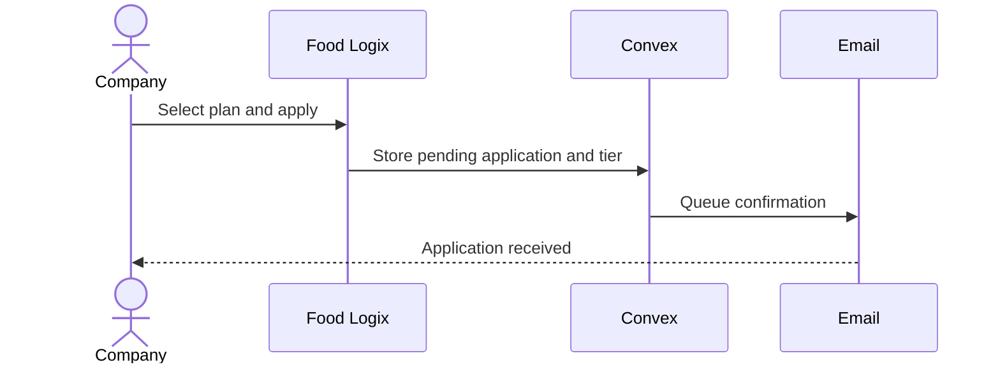
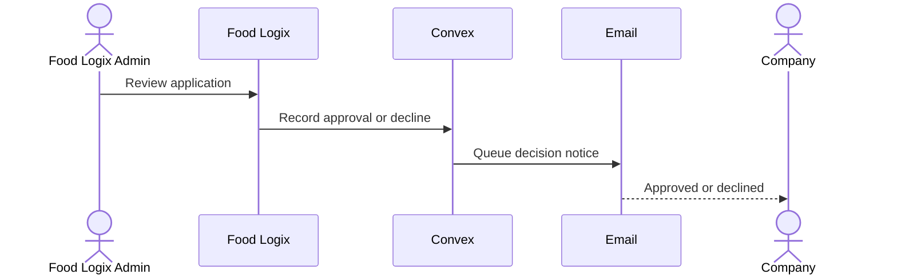
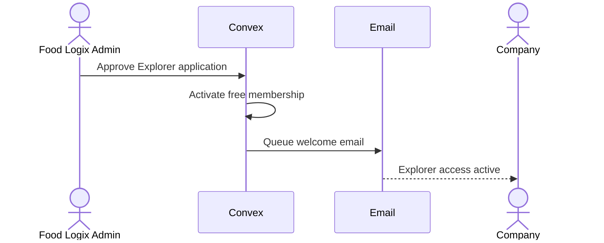
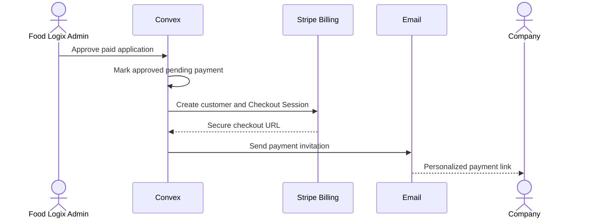
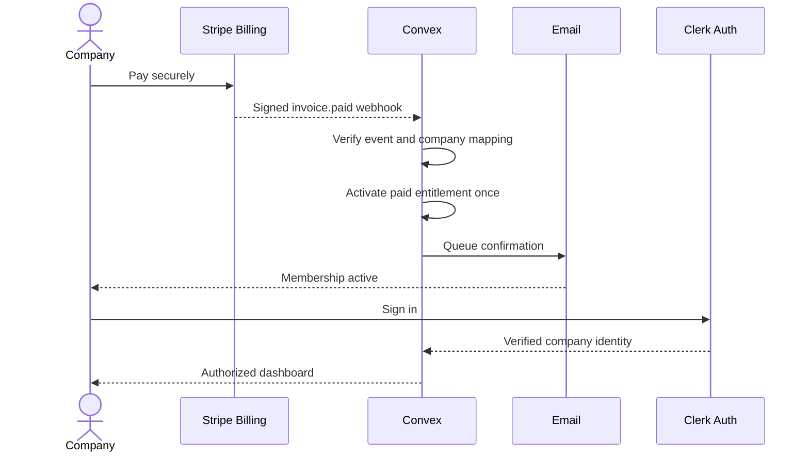
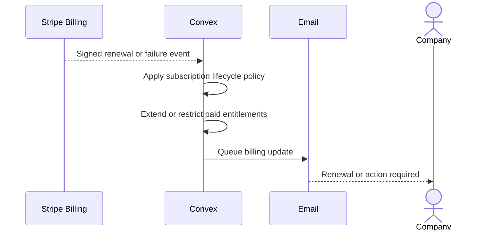

# Food Logix — Membership approval and Stripe Billing

Proposed business journey. Company approval comes before payment, paid membership activates only from verified Stripe events, and company verification remains separate.

## 1. Apply without payment
<!-- @id: apply -->
<!-- @message: The applicant chooses the intended membership and submits business information. -->
<!-- @message: Convex records the requested tier and pending review. -->
<!-- @message: The applicant receives an acknowledgement, not a payment request. -->
A company chooses Explorer, Pro, Premium or Enterprise and submits an application. No payment or member access is granted at this point.

## 2. Company review
<!-- @id: review -->
<!-- @message: An authorized Food Logix administrator evaluates the business. -->
<!-- @message: The approval or decline decision is audited. -->
<!-- @message: The applicant is informed of the decision. -->
Food Logix reviews the applicant. A declined application receives a notice and does not proceed to checkout.

## 3. Explorer activates for free
<!-- @id: explorer -->
<!-- @message: The free Explorer plan is approved. -->
<!-- @message: Convex activates Explorer entitlements. -->
<!-- @message: The applicant receives account access instructions. -->
For approved Explorer applications, the membership activates without Stripe checkout. Company verification and listing approval remain separate.

## 4. Paid plan receives payment link
<!-- @id: payment-link -->
<!-- @message: Food Logix approves the paid application. -->
<!-- @message: The backend records approved but pending payment. -->
<!-- @message: Stripe creates a customer-bound Checkout Session for the server-selected annual plan. -->
<!-- @message: The applicant receives a personalized secure link. -->
For approved Pro ($2,500/year), Premium ($5,000/year) or Enterprise ($10,000/year), create a customer-specific secure Stripe Checkout link. Approval alone never grants paid access.

## 5. Verified payment activates membership
<!-- @id: activation -->
<!-- @message: The company pays through Stripe-hosted Checkout. -->
<!-- @message: Stripe sends a signed payment webhook to Convex. -->
<!-- @message: Convex verifies and deduplicates the event before activating the matching plan. -->
<!-- @message: The company receives confirmation and accesses its membership with Clerk sign-in. -->
The backend verifies Stripe's signed paid-invoice event, checks plan and company mapping, and deduplicates retries. A successful browser redirect alone is not proof of payment.

## 6. Renewals, failures and cancellation
<!-- @id: renewals -->
<!-- @message: Stripe sends signed renewal or failed-payment events. -->
<!-- @message: Convex applies idempotent renewal, grace-period or expiry rules. -->
<!-- @message: The company receives the relevant billing notification. -->
Annual renewal events update the paid-through date. Failed payments, subscription cancellation and expiration follow an explicit grace-period and notification policy. Verified badges and listing moderation are not payment entitlements.

